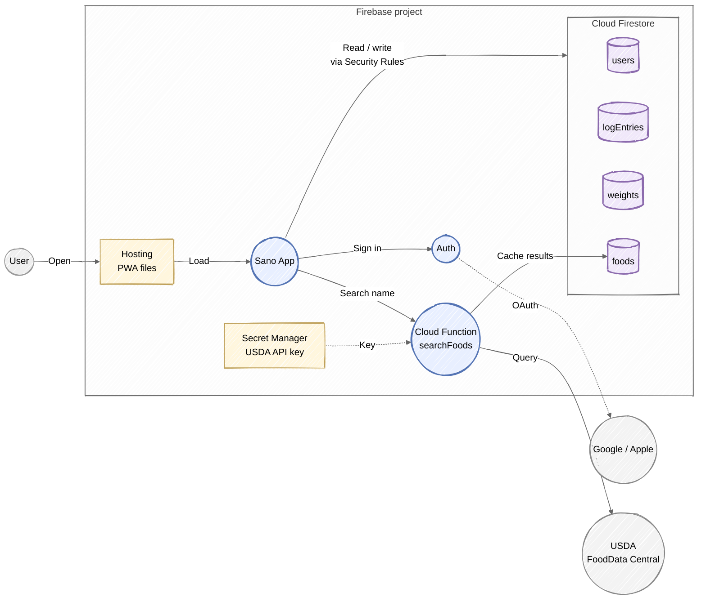
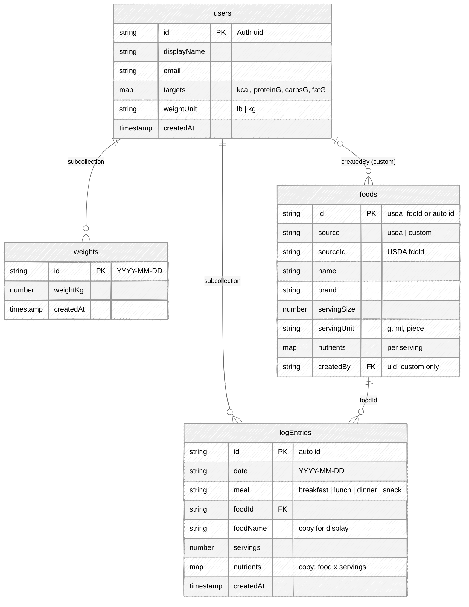
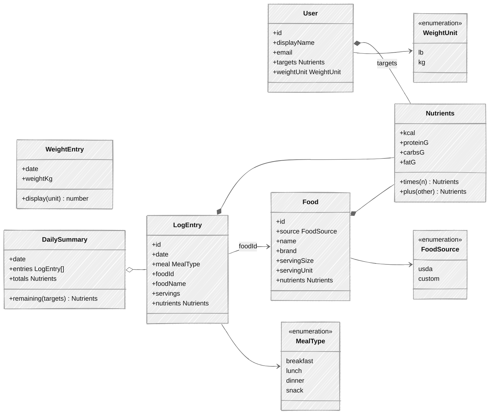
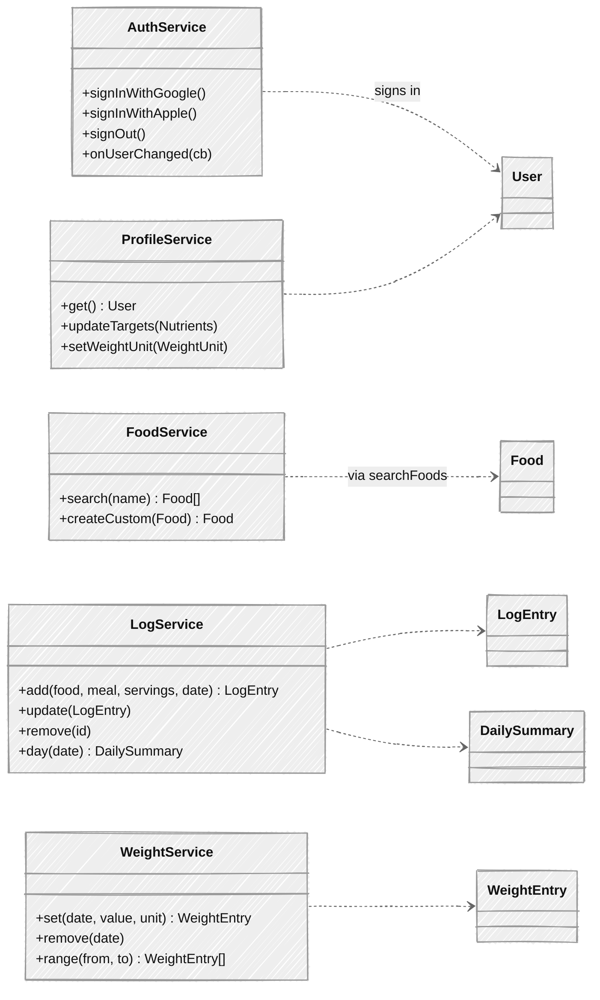

# Sano MVP: Nutrition + Weight Logging

## MVP scope

**Sign in**
- Google and Apple sign-in through Firebase Auth. Apple sign-in is required on iOS whenever Google is offered.
- Daily calorie and macro targets are entered by hand in the profile.

**Nutrition logging**
1. Search for a food by name. Results come from USDA FoodData Central (a free third-party API).
2. Choose a result, a meal (breakfast, lunch, dinner or snack) and the number of servings, then log it.
3. If a food isn't found, create a custom food by typing in the label values.
4. The Today view shows entries grouped by meal and totals against targets. Earlier days can be browsed.
5. Entries can be edited or deleted.

**Weight logging**
1. Log a weight (lb or kg) for a day, at most one per day. Logging again replaces that day's value.
2. See a list of entries and a simple trend chart (30 and 90 days).
3. Entries can be edited or deleted.

**Not in MVP:** barcode scanning, label photos, AI coach, recipes, pantry, onboarding quiz, reminders.

## Firebase components

- The app reads and writes Firestore directly through the Firebase SDK. Security Rules make sure each user can only access their own data.
- Only the `searchFoods` function talks to USDA, so the API key never ships in the app. Switching food APIs later means changing only this function.
- Cloud Functions and Secret Manager require the **Blaze** (pay-as-you-go) plan. At MVP traffic, usage stays within the free allowance.

## Data model (Firestore)

| Path | Who can access |
| --- | --- |
| `users/{uid}` | Owner only |
| `users/{uid}/logEntries/{id}` | Owner only |
| `users/{uid}/weights/{date}` | Owner only |
| `foods/{id}` | USDA foods: anyone signed in can read, only the function writes. Custom foods: creator only |

- Each log entry stores copies of the food's name and nutrients. A day's view then takes a single query by `date`, and history doesn't change if a food is edited later.
- A weight's document id is its date, which enforces one entry per day. Weights are stored in kg and converted for display using `weightUnit`.

## App entities

## App services

Each service is a thin wrapper around the Firebase SDK. `FoodService.search` is the only one that goes through Cloud Functions.
