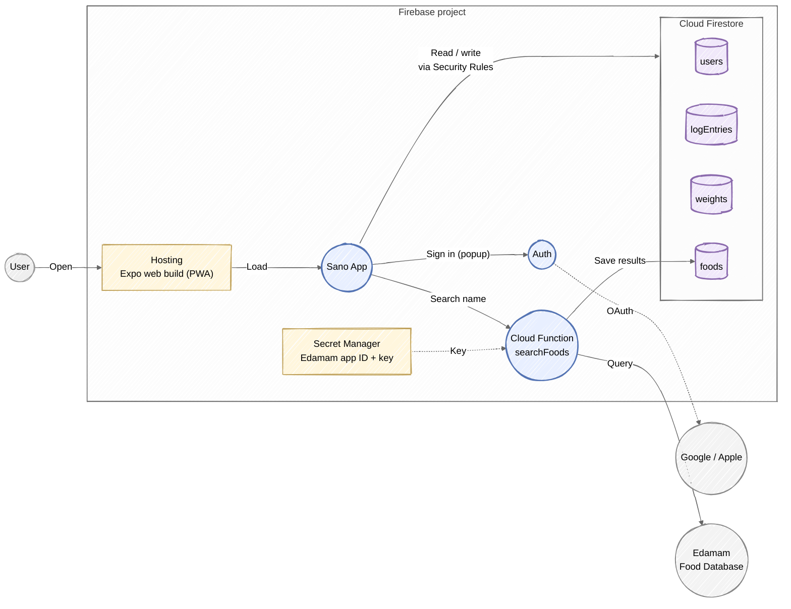
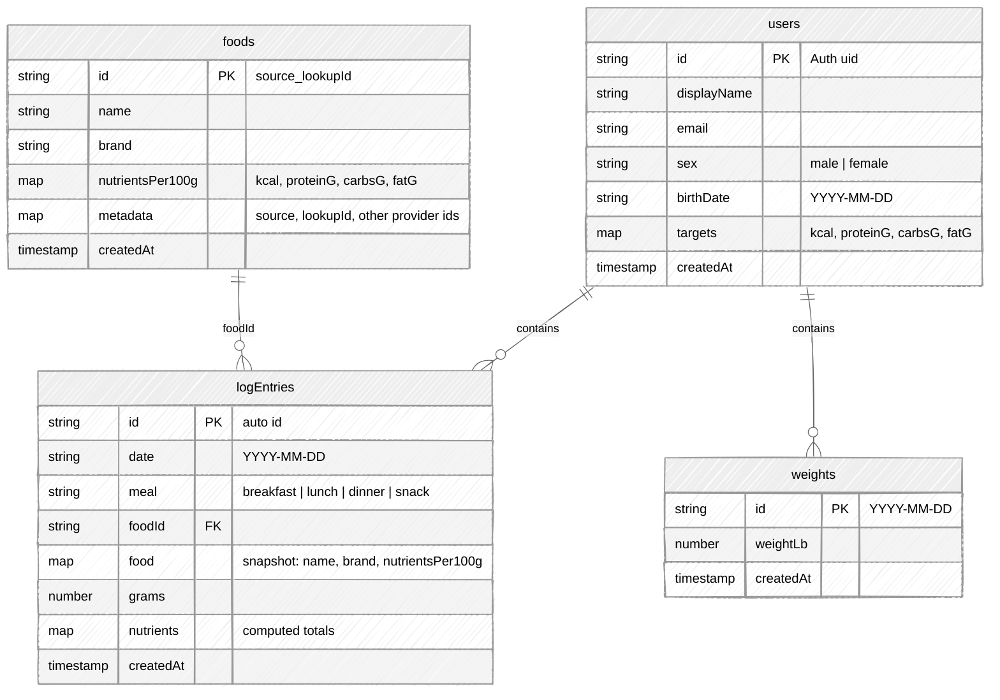
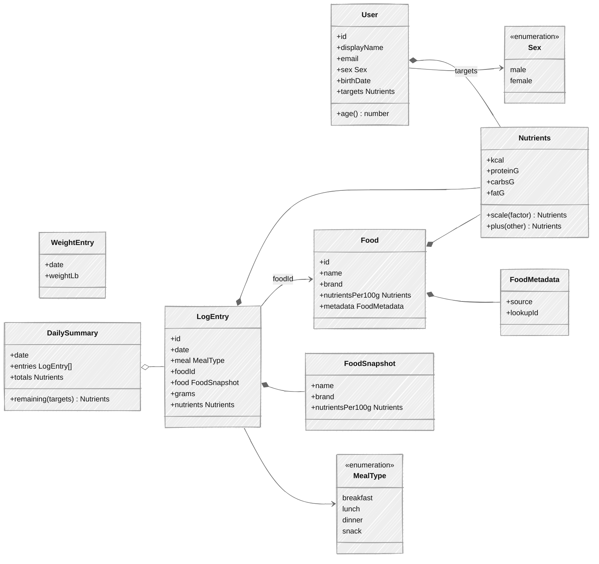
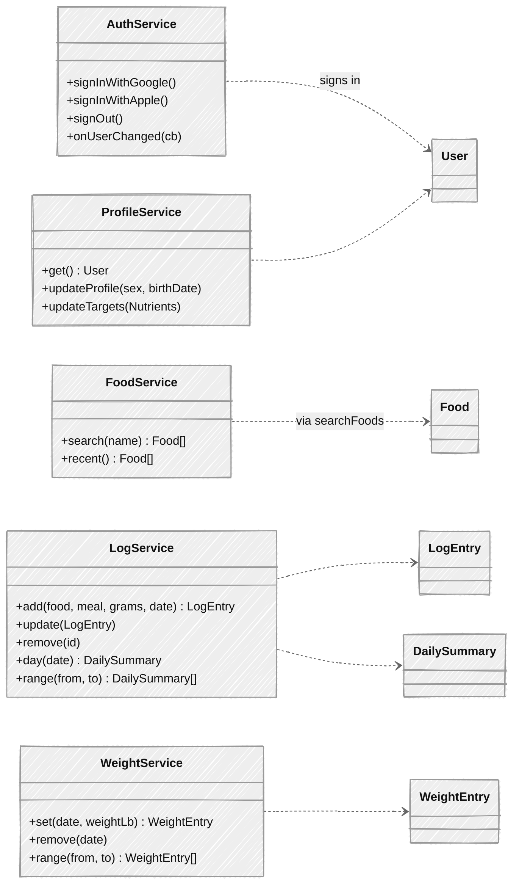

# Sano MVP: Nutrition + Weight Logging

## Stack

- **App:** Expo (React Native) with NativeWind (Tailwind for React Native) and `lucide-react-native` icons. The MVP ships as a **PWA**: an Expo web build (`npx expo export -p web`) served from Firebase Hosting. The same code becomes the iOS and Android apps later.
- **Backend:** Firebase only: Hosting, Auth, Cloud Firestore, Cloud Functions and Secret Manager, used through the Firebase JS SDK.
- **Sign-in:** Firebase Auth's web sign-in with a popup (`signInWithPopup`) for Google and Apple. Apple sign-in needs an Apple Developer account ($99/year) to set up its Services ID. Test the popup early in an iPhone home-screen install, where web sign-in is most likely to break.
- **Food data:** Edamam Food Database API, called only from Cloud Functions.

**Later, for the App Store:** native Apple and Google sign-in (`expo-apple-authentication`, `@react-native-google-signin/google-signin`) in an Expo development build, in-app account deletion (Apple requires it), and EAS builds and store submission.

## MVP scope

**Sign in**
- Google and Apple sign-in through Firebase Auth. Offering Apple from the start also covers the App Store rule that apps with Google sign-in must offer Apple too.
- The profile holds sex, birth date and daily calorie and macro targets, all entered by hand. Targets start at 2200 kcal, 150 g protein, 220 g carbs and 70 g fat.

**Navigation** (layout borrowed from MacroFactor)
- Tab bar: Dashboard · Food Log · **+** · Coach · Profile. The center **+** is the only way to log: it opens "Log food" or "Log weight". Coach (AI chat) is shown greyed out and isn't built in the MVP.
- Dashboard: a week grid of calories, protein, fat and carbs per day against targets, with a Consumed/Remaining toggle for the selected day. Below it are a 7-day calorie average and a weight trend card. The weight card opens the Weight screen (history and trend).

**Nutrition logging**
1. Search for a food by name. Results come from the Edamam Food Database API (Basic plan, $14/month after a 30-day trial).
2. Choose a result, a meal (breakfast, lunch, dinner or snack) and the amount eaten in grams, then log it.
3. Recently logged foods can be logged again without searching.
4. Food Log shows a day's entries grouped by meal, with totals against targets. Earlier days can be browsed and logged to, but future days can't.
5. Entries can be edited or deleted.

**Weight logging**
1. Log a weight in lb for a day, at most one per day. Logging again replaces that day's value.
2. See a list of entries and a simple trend chart (30 and 90 days).
3. Entries can be edited or deleted.

**Not in MVP:** App Store and Play Store apps, account deletion, custom foods, serving sizes, other units, barcode scanning, label photos, AI coach, recipes, pantry, onboarding quiz, reminders.

## Firebase components

- The app reads and writes Firestore directly through the Firebase SDK. Security Rules make sure each user can only access their own data.
- Only the `searchFoods` function talks to Edamam, so the API credentials never ship in the app. It also saves the foods it returns to the global `foods` collection, which the app can only read. Switching food APIs later means changing only this function. It's a callable function that only answers signed-in users, and the app waits until typing pauses before searching, to stay within Edamam's rate limit.
- Cloud Functions and Secret Manager require the **Blaze** (pay-as-you-go) plan. At MVP traffic, usage stays within the free allowance. Edamam Basic is the only fixed cost ($14/month after the trial).

## Data model (Firestore)

| Path | Who can access |
| --- | --- |
| `foods/{id}` | Anyone signed in can read. Only the `searchFoods` function writes |
| `users/{uid}` | Owner only |
| `users/{uid}/logEntries/{id}` | Owner only |
| `users/{uid}/weights/{date}` | Owner only |

- `foods` is shared by all users. A food's `metadata` holds where it came from (e.g. `{ source: "edamam", lookupId: "food_abc123" }`), and the document id is built from those two values, so each food is stored once.
- One unit each, with no conversion: food in grams, body weight in lb.
- Users store a birth date, not an age, so age never goes stale. The app calculates it.
- A log entry stores a snapshot of the food (`name`, `brand`, `nutrientsPer100g`) taken when it's logged, the grams eaten and the computed nutrient totals (`nutrientsPer100g` × grams / 100). Edits recalculate from the snapshot, so past entries never change even if `foods/{id}` is updated. `foodId` still links to the shared food for recent foods and re-logging. A day's view then takes a single query by `date`, and recent foods come from the user's latest log entries.
- Dates are the user's local calendar day (`YYYY-MM-DD`). The Dashboard week and 7-day average use one range query on `date`. No composite indexes are needed.
- A weight's document id is its date, which enforces one entry per day.
- **Open item:** Edamam's terms limit storing its data. For the MVP we store food details anyway, so past logs stay correct if Edamam changes a food. Confirm the terms before a wider launch. Fallback if they rule this out: USDA FoodData Central, which is public domain and can be stored freely, though its search and brand coverage are weaker.

## App entities

## App services

Each service is a thin wrapper around the Firebase SDK. `FoodService.search` is the only one that goes through Cloud Functions.
