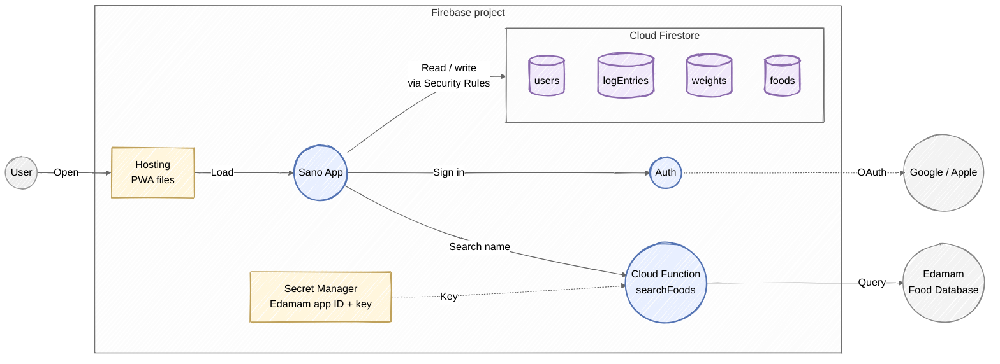
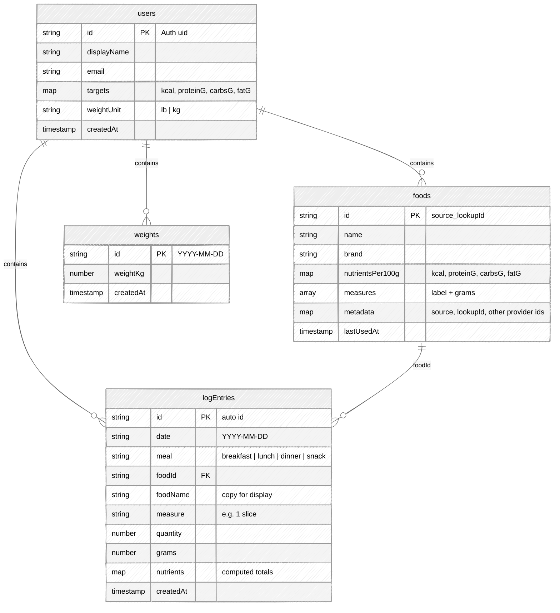
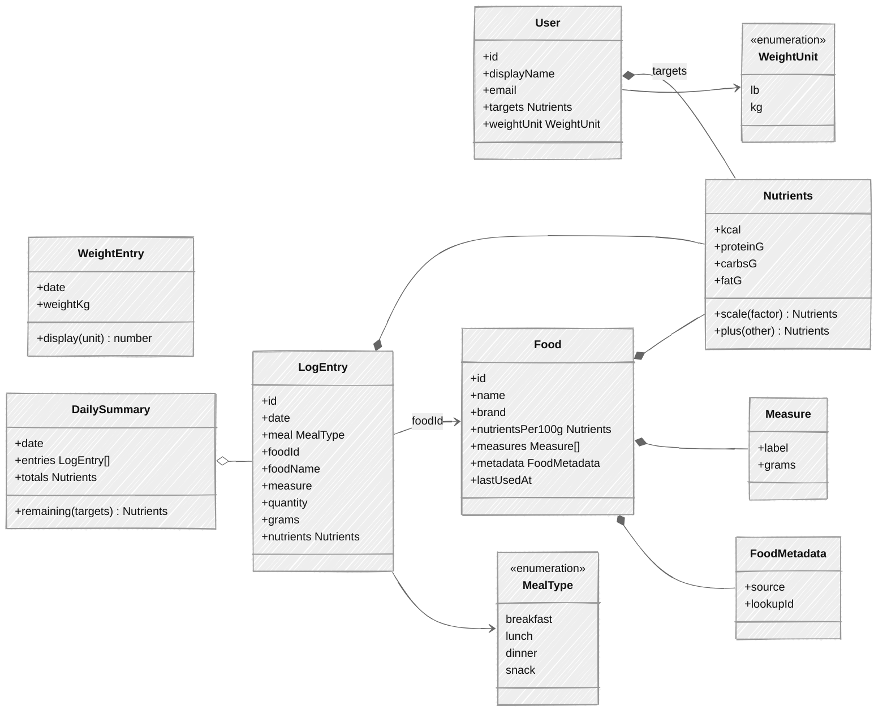
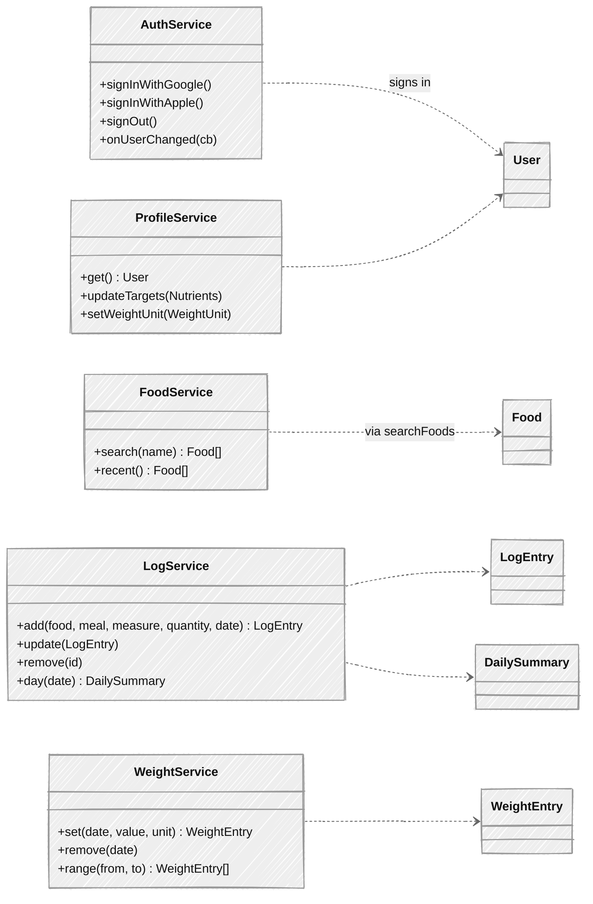

# Sano MVP: Nutrition + Weight Logging

## MVP scope

**Sign in**
- Google and Apple sign-in through Firebase Auth. Apple sign-in is required on iOS whenever Google is offered.
- Daily calorie and macro targets are entered by hand in the profile.

**Nutrition logging**
1. Search for a food by name. Results come from the Edamam Food Database API (Basic plan, $14/month after a 30-day trial).
2. Choose a result, a meal (breakfast, lunch, dinner or snack) and an amount (e.g. 2 slices or 150 g), then log it.
3. Logged foods are saved to the user's recent foods so they can be logged again without searching.
4. The Today view shows entries grouped by meal and totals against targets. Earlier days can be browsed.
5. Entries can be edited or deleted.

**Weight logging**
1. Log a weight (lb or kg) for a day, at most one per day. Logging again replaces that day's value.
2. See a list of entries and a simple trend chart (30 and 90 days).
3. Entries can be edited or deleted.

**Not in MVP:** custom foods, barcode scanning, label photos, AI coach, recipes, pantry, onboarding quiz, reminders.

## Firebase components

- The app reads and writes Firestore directly through the Firebase SDK. Security Rules make sure each user can only access their own data.
- Only the `searchFoods` function talks to Edamam, so the API credentials never ship in the app. It only searches and never writes to Firestore. Switching food APIs later means changing only this function.
- Cloud Functions and Secret Manager require the **Blaze** (pay-as-you-go) plan. At MVP traffic, usage stays within the free allowance. Edamam Basic is the only fixed cost ($14/month after the trial).

## Data model (Firestore)

| Path | Who can access |
| --- | --- |
| `users/{uid}` | Owner only |
| `users/{uid}/foods/{id}` | Owner only |
| `users/{uid}/logEntries/{id}` | Owner only |
| `users/{uid}/weights/{date}` | Owner only |

- Everything lives under the user, so one Security Rule (owner only) covers all of it.
- When a food is first logged, the app saves its full details to `foods`. The food's `metadata` holds where it came from (e.g. `{ source: "edamam", lookupId: "food_abc123" }`), and the document id is built from those two values, so the same food is saved only once per user.
- Edamam gives nutrients per 100 g plus measures (1 slice = 30 g). A log entry stores the chosen measure, quantity and grams, plus the computed nutrient totals. A day's view then takes a single query by `date`.
- A weight's document id is its date, which enforces one entry per day. Weights are stored in kg and converted for display using `weightUnit`.
- **Open item:** Edamam's terms limit storing its data. For the MVP we store food details anyway, so past logs stay correct if Edamam changes a food. Confirm the terms (or switch providers) before a wider launch.

## App entities

## App services

Each service is a thin wrapper around the Firebase SDK. `FoodService.search` is the only one that goes through Cloud Functions. `LogService.add` saves the food to the user's `foods` (if it isn't there yet) and writes the entry.
