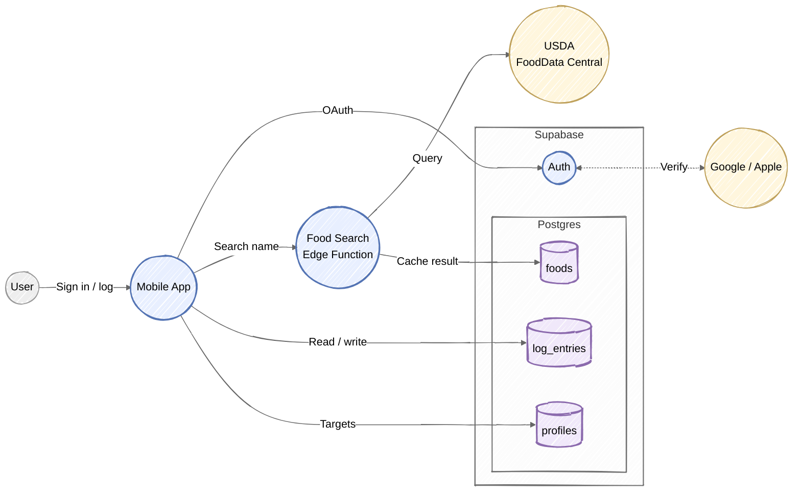
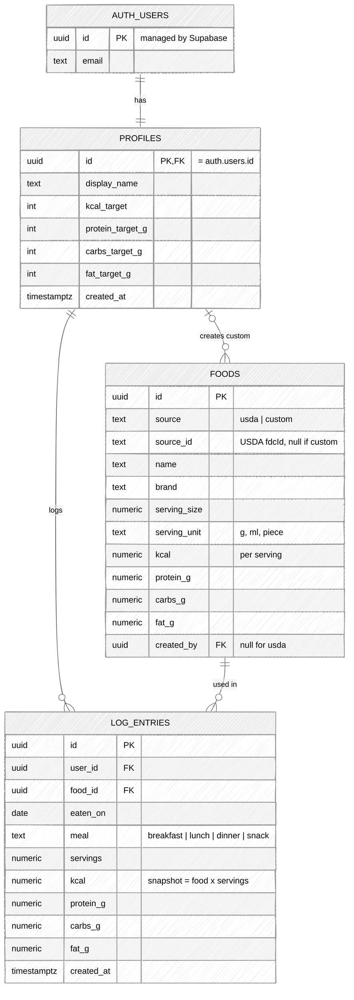
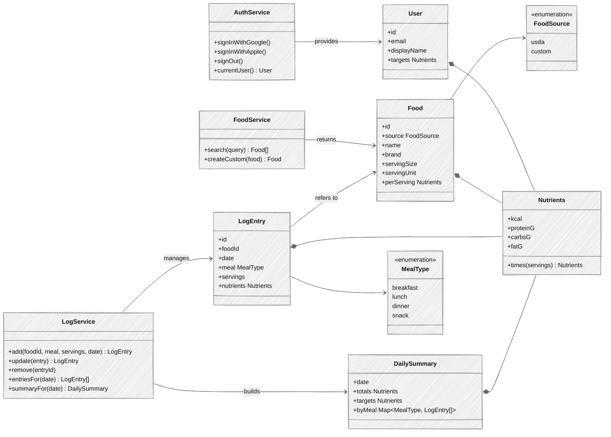

# Nutrition Logging MVP

Scope: sign in, search foods by name, log what you ate, see daily totals vs targets.
Out of scope for MVP: barcode scanning, nutrition-label photos, coach, onboarding.

**Stack (simplest plug-and-play):**
- **Mobile app:** Expo (React Native).
- **Auth + DB:** Supabase. Google and Apple sign-in come built in, and Postgres row-level security keeps each user's logs private.
- **Food data:** USDA FoodData Central (free API key). It's called through one Supabase Edge Function so the key never ships in the app.
- **Fallback:** if a food isn't found, the user types the label values into a custom food.

## Overview

Search results are saved in `foods` so a logged entry always points to a stable row.

## Data Model

- `foods` has a unique `(source, source_id)`, so each USDA food is cached once.
- `log_entries` stores a copy of the nutrient values taken when the entry is logged. History stays the same if a food is edited later, and daily totals come from a plain `SUM` with no joins.
- Row-level security: users read and write only rows where `user_id = auth.uid()`. USDA foods can be read by everyone. Custom foods can be read only by `created_by`.

## Class Diagram (app)

The three services are thin wrappers around the Supabase client (`FoodService.search` calls the edge function). The models match the tables one-to-one. `Nutrients` is the only shared value type.

## Later (not MVP)

- **Barcode scan:** add Open Food Facts (free, no key) as a third `FoodSource`.
- **Label photo:** on-device OCR fills in the custom-food form.
